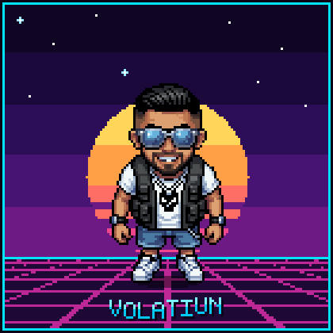

<!-- Banner animado -->
<p align="center">
  
</p>

<!-- Personagem em pixel art andando (feito no PixelLab, mesmo estilo dos agentes do AEGIS Trade) -->
<p align="center">
  
</p>

<p align="center">
  <a href="https://github.com/volatiun">
    
  </a>
</p>

<p align="center">
  
  
</p>

---

## 🕹️ Sobre mim

```txt
> PLAYER: VolatiuN
> CLASSE: Desenvolvedor em evolução
> BASE:   Brasil 🇧🇷
> MISSÃO: transformar ideias em projetos que funcionam
> XP:     ██████░░░░  subindo de nível todo dia...
```

- 🌱 Aprendendo e construindo projetos
- 🎮 Gamer nas horas vagas
- 😎 Óculos espelhado, sorriso no rosto e paz ✌️
- 💬 Bora trocar ideia sobre código, jogos e tecnologia

## 🧰 Tecnologias

<p align="center">
  
</p>

## 📊 Status do jogador

<!-- Card gerado pela GitHub Action (.github/workflows/perfil.yml) e salvo na branch "output" -->
<p align="center">
  
</p>

<p align="center">
  
</p>

## 🐍 A cobrinha comendo minhas contribuições

<p align="center">
  <picture>
    <source media="(prefers-color-scheme: dark)" srcset="https://raw.githubusercontent.com/volatiun/volatiun/output/snake-dark.svg"/>
    <source media="(prefers-color-scheme: light)" srcset="https://raw.githubusercontent.com/volatiun/volatiun/output/snake.svg"/>
    
  </picture>
</p>

<p align="center">
  
</p>
